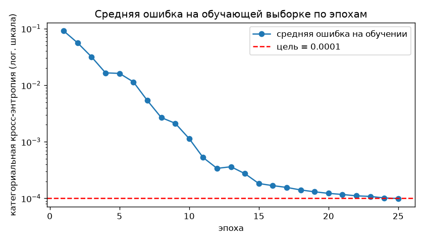
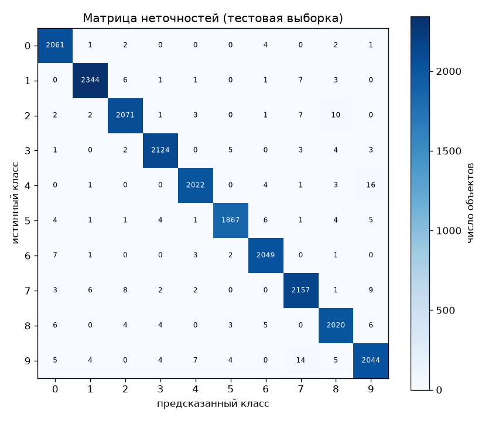
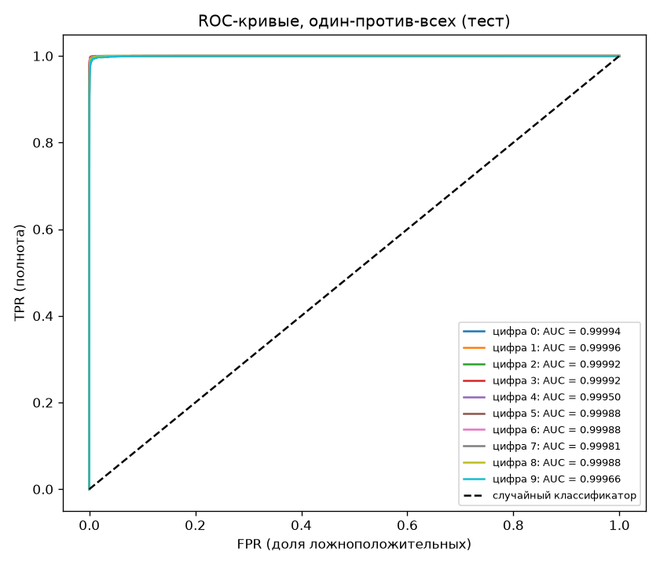
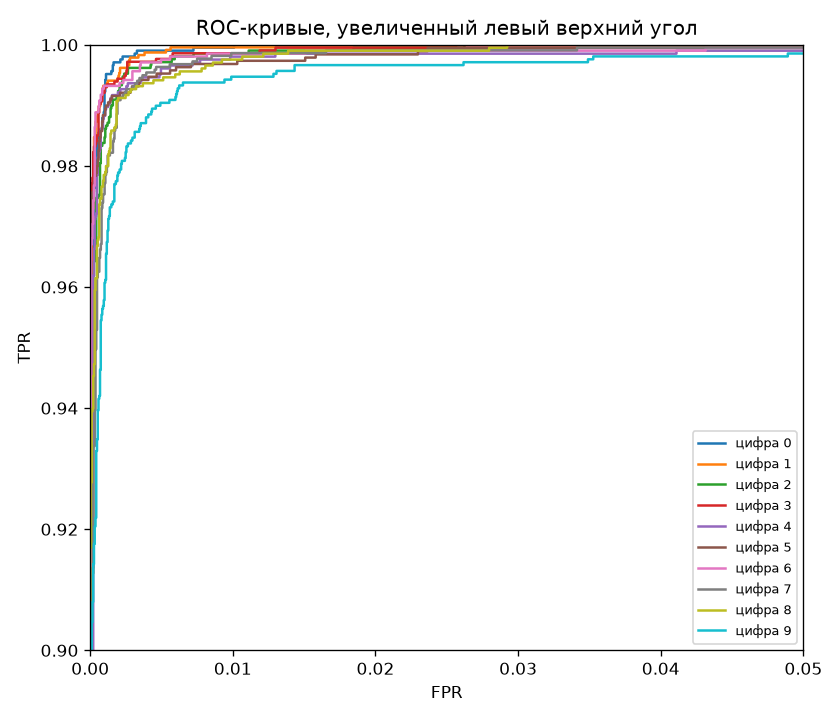
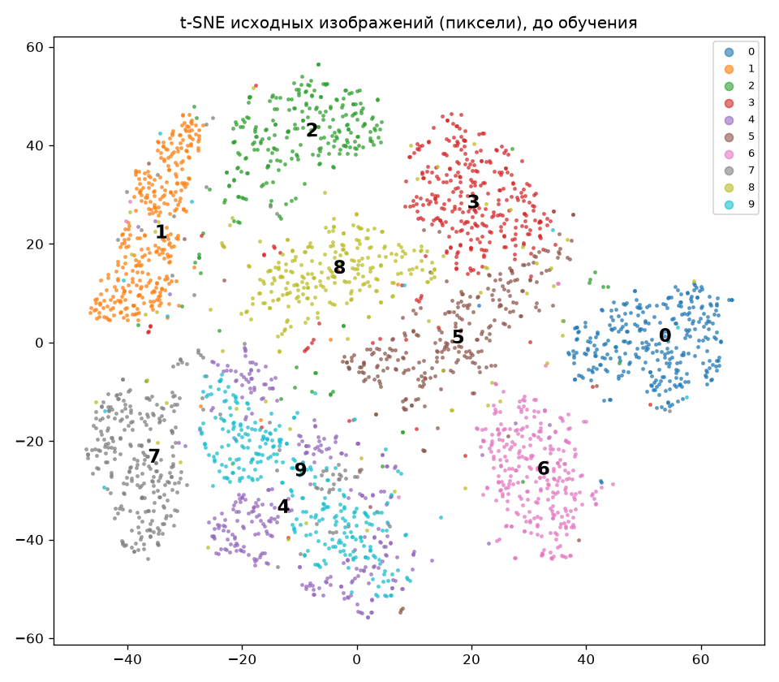
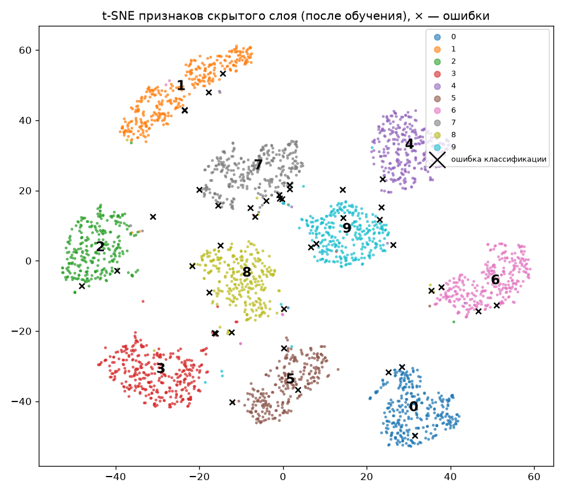
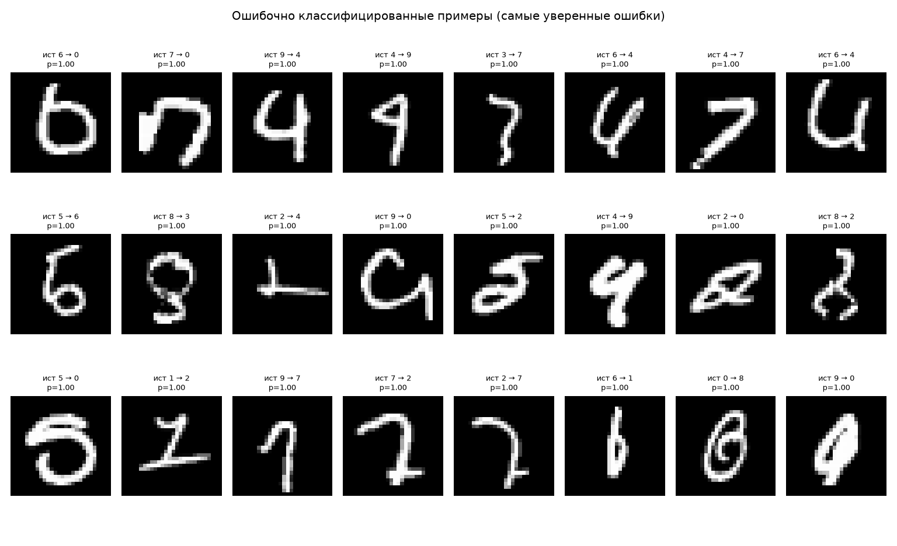

# Лабораторная 2. Свёрточная нейронная сеть

## Архитектура нейронной сети

На вход поступает одно изображение размером **28 × 28** в оттенках серого. Перед свёрткой к нему добавляется рамка из двух пикселей со значением `0` с каждой стороны, поэтому размер становится **32 × 32**. Затем значения пикселей приводятся к диапазону `[-0.5, 0.5]` по формуле `x / 255 - 0.5`.

Сеть состоит из **четырёх слоёв**. Обучаемые параметры есть у свёрточного и двух полносвязных слоёв.

| № | Слой | Вход | Операция | Выход |
|---|---|---|---|---|
| 1 | Свёрточный слой с ReLU (`convolutional_layer`) | Изображение `32 × 32` | Применяет 6 фильтров `5 × 5` с шагом 1. Затем применяет ReLU к каждой карте признаков. | `28 × 28 × 6` |
| 2 | Max-pooling (`MaxPoll`) | 6 карт признаков размером `28 × 28` | Выбирает максимум в каждом окне `2 × 2` с шагом 2 отдельно для каждой карты. | `14 × 14 × 6` |
| 3 | Скрытый полносвязный слой с ReLU (`Dense`) | 6 карт признаков размером `14 × 14` | Разворачивает карты в вектор из `1176` элементов, преобразует его в `128` признаков и применяет ReLU. | Вектор из `128` элементов |
| 4 | Выходной полносвязный слой с softmax (`SoftMax`) | Вектор из `128` элементов | Вычисляет 10 логитов и преобразует их в вероятности с помощью softmax. | Вектор из `10` вероятностей |

Предсказанная цифра — индекс наибольшей вероятности в выходном векторе.

### Почему такая архитектура

1. **Свёртка 5×5, 6 фильтров, вход 32×32** первый слой LeNet-5 Фильтры учатся находить штрихи, края и изгибы.
2. **Max-pooling 2×2** уменьшает карту признаков в 4 раза и даёт небольшую устойчивость к сдвигу цифры.
3. **ReLU после свёртки и скрытого слоя.** Без нелинейности свёртка и полносвязный слой это одно линейное преобразование.
4. **Скрытый слой на 128 нейронов.** Без него (свёртка → пулинг → softmax) средняя ошибка на обучении останавливается около **0,04** (проверено: 12 эпох, 0,0907 → 0,0401). Требуемая ошибка 0,0001 в 400 раз меньше, и сети просто не хватает ёмкости.

### Функция ошибки - категориальная кросс-энтропия

Так как задача многоклассовая, она имеет: 10 взаимоисключающих классов. Поэтому на выходе **softmax**, а функция ошибки  **категориальная кросс-энтропия**:

$$
L=-\sum_{c=0}^{9} y_c\ln p_c=-\ln p_y,
$$

где (p_c) — вероятность класса (c), (y) — правильная цифра, а (y_c) равно 1 для правильного класса и 0 для остальных.

В MNIST каждое изображение относится к одной из десяти цифр. Чтобы получить вероятности этих классов с суммой 1, к десяти выходным логитам (z_c) применяется softmax.

$$
p_c=\frac{e^{z_c}}{\sum_{k=0}^{9}e^{z_k}}.
$$

Градиент softmax вместе с кросс-энтропией получается простой из вероятности вычитае предсказанную метка класса: `dL/dz = p − onehot(y)`. В `softmax.py` это строки `dl_dt = self.last_output.copy(); dl_dt[label] -= 1`.

**Средняя ошибка** — это среднее `L` по всем 49 000 обучающим примерам. Её считают после каждой эпохи (функция `evaluate`).

## Обучение

- SGD по одному примеру, данные перемешиваются каждую эпоху.
- Шаг обучения убывает: `lr = 0.01 / (1 + 0.1·эпоха)`.
- Остановка: средняя ошибка на обучении ≤ **0,0001** (максимум 60 эпох).

**Целевая ошибка достигается на 25-й эпохе: 0,000099**, точность на обучении 100 %.

Чтобы средняя кросс-энтропия была 0,0001, сеть должна давать правильному классу вероятность ≈ 0,9999 в среднем и не ошибаться почти ни на одном обучающем примере.

## Результаты на тестовой выборке (21 000 изображений)

| Метрика | Значение |
|---|---|
| Accuracy | **0,9885** |
| Precision (macro) | 0,9885 |
| Recall (macro) | 0,9885 |
| F1 (macro) | 0,9885 |
| AUC (macro, один-против-всех) | **0,99983** |
| Средняя ошибка на тесте | 0,064 |

Precision, Recall и F1 - среднее по 10 классам.

Доля правильных ответов сети среди всех тестовых примеров составила **98,85%**, то есть почти 99%. Среди объектов, которые модель отнесла к нужному классу, в среднем 98,85% действительно к нему относятся (Precision). Доля найденных моделью объектов нужного класса среди всех объектов этого класса в среднем тоже составила 98,85% (Recall).

F1 считаем как гармоническое среднее Precision и Recall для каждого класса. После усреднения получаем 0,9885.

AUC считаем по принципу «один против всех». То есть смотрим, насколько хорошо сеть отличает каждую цифру от остальных. Средний AUC получился **0,99983**. Средняя ошибка на тесте, то есть средняя категориальная кросс-энтропия по всем тестовым примерам, составила 0,064.

| Цифра | Precision | Recall | F1 | AUC |
|---|---|---|---|---|
| 0 | 0,9866 | 0,9952 | 0,9909 | 0,99994 |
| 1 | 0,9932 | 0,9920 | 0,9926 | 0,99996 |
| 2 | 0,9890 | 0,9876 | 0,9883 | 0,99992 |
| 3 | 0,9925 | 0,9916 | 0,9921 | 0,99992 |
| 4 | 0,9917 | 0,9878 | 0,9897 | 0,99950 |
| 5 | 0,9926 | 0,9857 | 0,9891 | 0,99988 |
| 6 | 0,9899 | 0,9932 | 0,9915 | 0,99988 |
| 7 | 0,9849 | 0,9858 | 0,9854 | 0,99981 |
| 8 | 0,9839 | 0,9863 | 0,9851 | 0,99988 |
| 9 | 0,9808 | 0,9794 | 0,9801 | 0,99966 |

### ROC и AUC

Для каждой цифры строится кривая «один против всех»: класс $c$ считается положительным, остальные девять отрицательными, а оценкой служит вероятность $p_c$ на выходе softmax. Примеры сортируются по убыванию $p_c$, порог опускается от большей вероятности к меньшей, и на каждом шаге считаются

$$
\text{TPR}=\frac{TP}{TP+FN},\qquad \text{FPR}=\frac{FP}{FP+TN}.
$$

Примеры с одинаковой вероятностью проходят порог одновременно. AUC — площадь под кривой, посчитанная методом трапеций. Итоговый AUC — среднее по 10 классам.

Модель хорошо отличает каждую цифру от остальных. Все рок кривые проходят близко к верх.лев. углу. Самый низкий AUC(площадь под кривой) у цифры 5, самый низкий А1 - у цифры 9. На увеличенном графике при малых FPR хуже всех выглядит кривая 9. AUC у четвёрки ниже из-за «хвоста» кривой: несколько четвёрок сеть уверенно отнесла к другим цифрам и дала своему классу вероятность около нуля, поэтому они попадают в самый конец сортировки.

## t-SNE и причины ошибок

**До обучения** t-SNE строится по сырым пикселям 3000 тестовых изображений:

Облака 0, 1, 2, 6 и 7 отделены хорошо. Облака **4 и 9 почти полностью перемешаны**, а 3, 5 и 8 соприкасаются. По пикселям эти цифры похожи, и по t-SNE можно заранее сказать, где сеть будет ошибаться.

**После обучения** t-SNE строится по выходу скрытого слоя (128 признаков), крестиками отмечены ошибки:

Сеть развела все 10 классов в отдельные кластеры. Ошибки лежат на краях кластеров или внутри чужого кластера: такие изображения похожи на другую цифру больше, чем на свою.

Самые частые ошибки по матрице неточностей:

| Истинная → предсказанная | Сколько | Причина |
|---|---|---|
| 4 → 9 | 16 | закрытый верх у 4 превращает её в 9; на t-SNE пикселей эти классы перемешаны |
| 9 → 7 | 14 | маленькая или незамкнутая петля у 9 |
| 2 → 8 | 10 | петля внизу у 2 |
| 7 → 9 | 9 | 7 с перечёркиванием или загнутым верхом |
| 7 → 2 | 8 | 7 с горизонтальной чертой внизу |
| 6 → 0 | 7 | короткий хвост у 6 |

Причины ошибок:

1. **Похожая форма цифр** (4/9, 7/9, 3/5/8). Такие классы перекрываются уже на t-SNE пикселей.
2. **Нетипичный почерк**: наклон, толстые или прерывистые линии, лишние штрихи:

3. **Неоднозначная или неверная разметка**: некоторые изображения и человек не отнесёт однозначно к одной цифре.
4. **Переобучение.** Ошибка на тесте (0,064) в 600 раз больше, чем на обучении (0,0001). Цель 0,0001 заставляет сеть стать почти на 100 % уверенной на обучающих примерах, поэтому на тестовых ошибках она тоже ошибается очень уверенно (p ≈ 1,00 на `errors.png`). Точность на тесте при этом высокая: 98,85 %.

## Обучение

- SGD по одному примеру, данные перемешиваются каждую эпоху.
- Остановка: средняя ошибка на обучении ≤ **0,0001** (максимум 60 эпох).

### Шаг обучения

Шаг обучения уменьшается с каждой эпохой:

$$
\text{lr}_t=\frac{\text{lr}_0}{1+k\cdot t},\qquad \text{lr}_0=0{,}01,\quad k=0{,}1,
$$

где $t$ — номер эпохи, начиная с 0.

| Эпоха | 1 | 2 | 6 | 11 | 21 | 25 |
|---|---|---|---|---|---|---|
| lr | 0,0100 | 0,0091 | 0,0067 | 0,0050 | 0,0033 | 0,0029 |

**Зачем уменьшать шаг.** Веса обновляются после каждой картинки, поэтому градиент шумный: каждый пример тянет веса немного в свою сторону. В начале обучения это не мешает, и большой шаг быстро ведёт к минимуму. Около минимума постоянный шаг заставляет веса колебаться вокруг него, и ошибка перестаёт падать. Цель 0,0001 требует очень точно попасть в минимум, поэтому шаг нужно уменьшать, чтобы колебания затухали.

На графике ошибки это видно: в первые эпохи ошибка падает быстро, а после 15-й эпохи, когда шаг уже маленький, — медленно и без скачков.

**Почему вид $1/t$.** Это классическое расписание для стохастического градиентного спуска. Для сходимости шаги должны удовлетворять условиям Роббинса — Монро:

$$
\sum_t \text{lr}_t=\infty,\qquad \sum_t \text{lr}_t^2<\infty.
$$

Первое условие означает, что сеть не «замрёт» раньше, чем дойдёт до минимума. Второе — что шум со временем гаснет. Постоянный шаг нарушает второе условие, расписание вида $1/t$ удовлетворяет обоим.

**Зачем коэффициенты.** Единица в знаменателе убирает деление на ноль, и первая эпоха идёт ровно с $\text{lr}_0$. Коэффициент $k=0{,}1$ задаёт скорость затухания: шаг падает вдвое за 10 эпох. При $k=1$ он упал бы вдвое уже ко второй эпохе и к 25-й был бы в 25 раз меньше начального, и сеть остановилась бы раньше, чем достигла цели. Значения $\text{lr}_0$ и $k$ подобраны экспериментально.